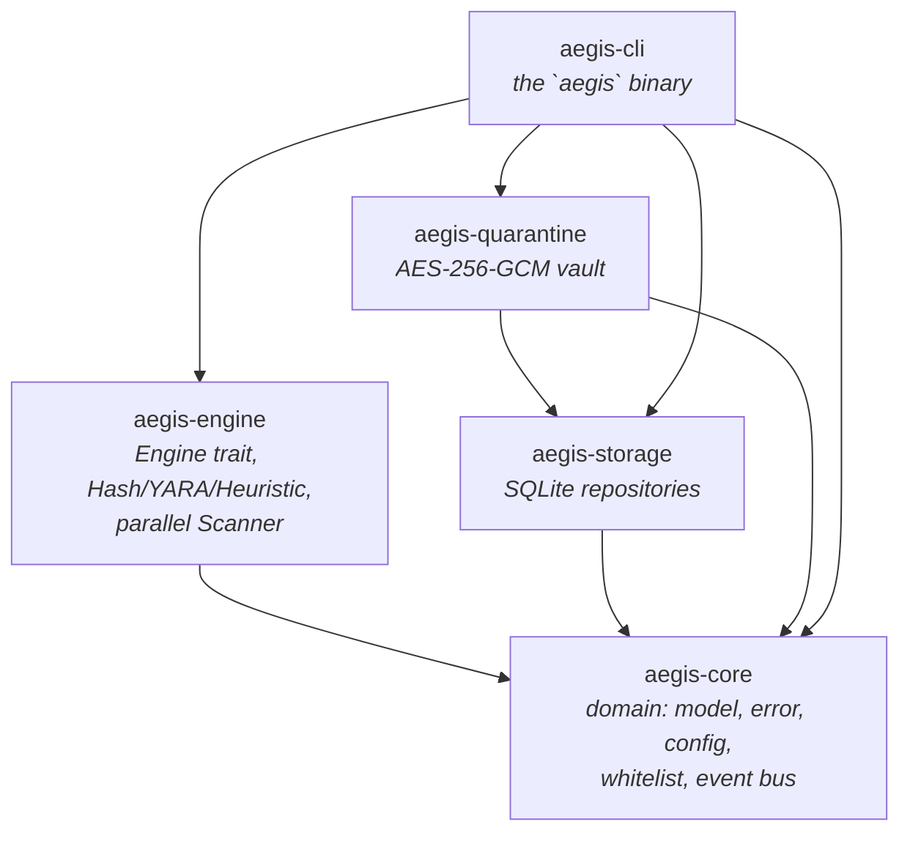
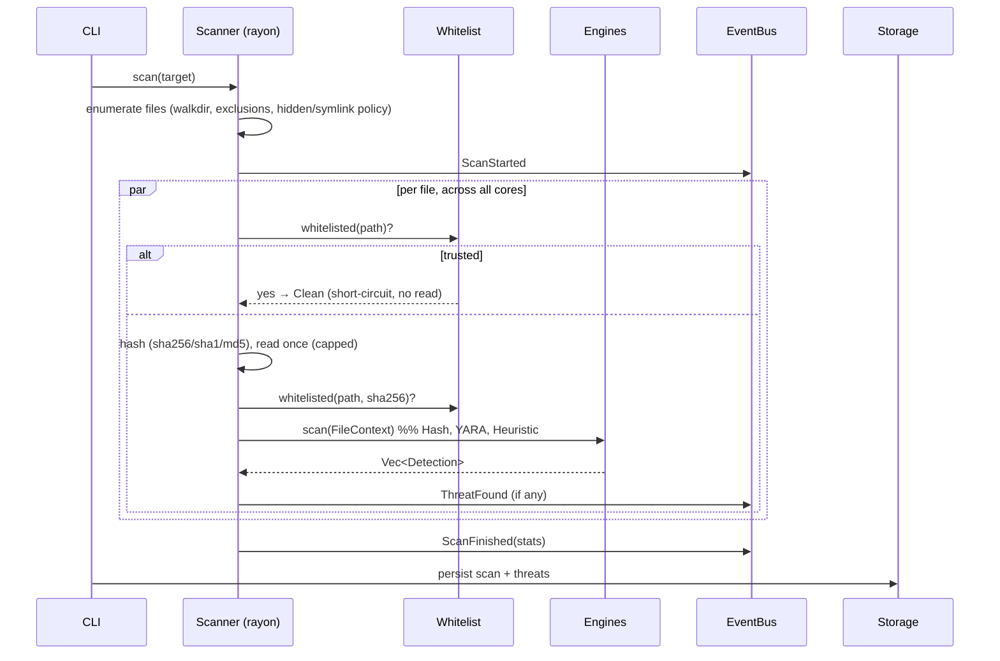

# Aegis Architecture

## Principles

Aegis follows **Clean Architecture** and **Domain-Driven Design**: dependencies
point inward, the domain layer (`aegis-core`) knows nothing about I/O, SQL,
crypto or UI, and each outer layer depends only on the ones beneath it. This
keeps the security-critical logic small, `unsafe`-free, and unit-testable.

Cross-cutting patterns in use:

| Pattern | Where |
|---|---|
| **Strategy** | `Engine` trait — each detection backend is interchangeable |
| **Repository** | `aegis-storage` — SQL hidden behind `ScanRepository` / `QuarantineIndex` |
| **Observer / Event Bus** | `aegis_core::EventBus` — engines publish, front-ends subscribe |
| **Composition Root / DI** | `aegis-cli::context::App` wires services together |
| **Builder-ish factory** | `aegis_engine::default_engines()` assembles the engine set from config |

## Crate graph



`aegis-core` has **no internal dependencies** — it is the stable center.

## Scan data flow



### Why the whitelist is checked first
Trusted project files short-circuit to `Clean` **before hashing or reading**,
which (a) eliminates false positives on your own code and (b) makes re-scanning
a large trusted tree nearly free.

### Zero-copy engine fan-out
Each file is read from disk **once** into a capped buffer, then every engine
receives the same `&[u8]` via `FileContext`. N engines cost one read, not N.

## Detection engines (Milestone 1)

| Engine | Technique | Severity |
|---|---|---|
| **Hash** | O(1) set lookup of SHA-256 against a known-bad DB | Critical on match |
| **YARA** | `yara-x` rules (bundled + user); metadata drives severity | rule-defined |
| **Heuristic** | Shannon entropy on ELF/PE, packer markers, behavioural byte-patterns (reverse shells, droppers, miners, persistence) | Low–High |

A file's final severity is the **max** across all engine detections, so
independent engines reinforce each other (consensus).

## Security posture

- `#![forbid(unsafe_code)]` in every crate.
- Quarantine uses **AES-256-GCM** (authenticated encryption): confidentiality +
  tamper detection. The vault key is a per-install 256-bit random key stored
  `0600`; the quarantine directory is `0700`.
- No hardcoded secrets. No network calls in M1 (offline by default).
- The daemon unit (`packaging/aegis-daemon.service`) is pre-hardened with the
  systemd sandbox (`ProtectSystem=strict`, dropped capabilities, seccomp
  `@system-service`) ahead of the M2 daemon.

## Performance design

- **Parallelism**: rayon work-stealing over the file list; scales to all cores.
- **Single read** per file, capped (default 8 MiB scan window, configurable).
- **Streaming hashing**: SHA-256/1/MD5 computed in one pass over 1 MiB chunks.
- **Release profile**: thin LTO, `codegen-units = 1`, `panic = "abort"`, stripped.
- Benchmarks (`cargo bench -p aegis-engine`) cover entropy and hashing hot paths.

## Testing strategy

- **Unit tests** live beside the code in every module (`#[cfg(test)]`).
- **Behavioural tests** assert real detections (EICAR, reverse shells) and the
  whitelist short-circuit end-to-end through the orchestrator.
- **Crypto round-trip tests** prove quarantine restore is byte-identical and
  that a tampered blob is rejected by the GCM tag.

## Forward-looking module layout

The spec's module list maps onto future crates, added milestone by milestone:

```
aegis-core        ✅ domain
aegis-engine      ✅ scanner/engine/heuristics   (+ M3: behavior, memory, rootkit)
aegis-storage     ✅ persistence
aegis-quarantine  ✅ quarantine
aegis-daemon      ▢ M2  daemon, scheduler, fanotify real-time
aegis-ipc         ▢ M2  Axum IPC API (daemon ⇄ CLI/UI)
aegis-behavior    ▢ M3  eBPF/Landlock/seccomp, ransomware guard
aegis-firewall    ▢ M5  nftables manager
aegis-network     ▢ M5  network IDS
aegis-plugins     ▢ M5  signed plugin SDK
aegis-ui (Tauri)  ▢ M4  React/TS/Tailwind/shadcn
```
