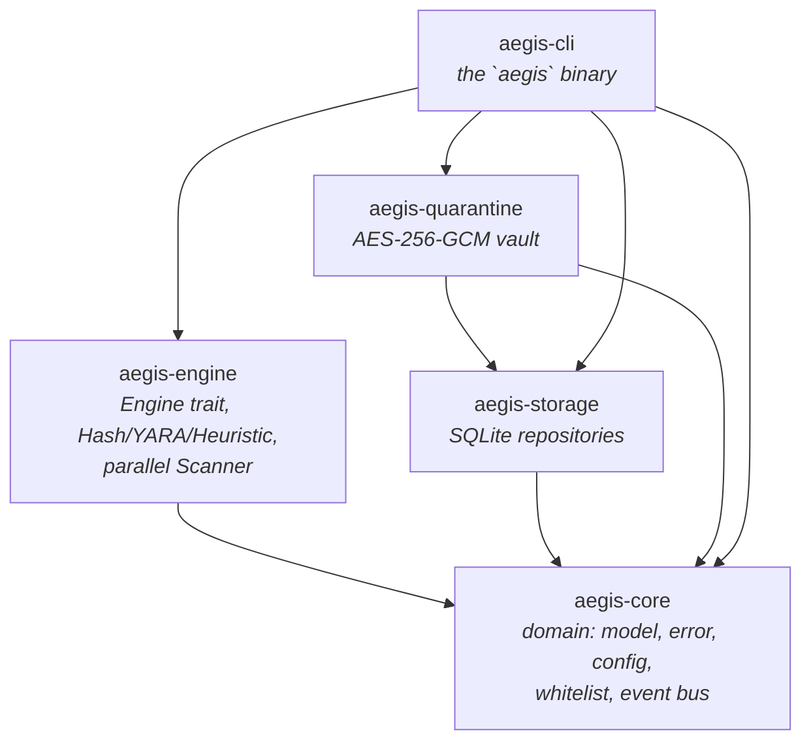
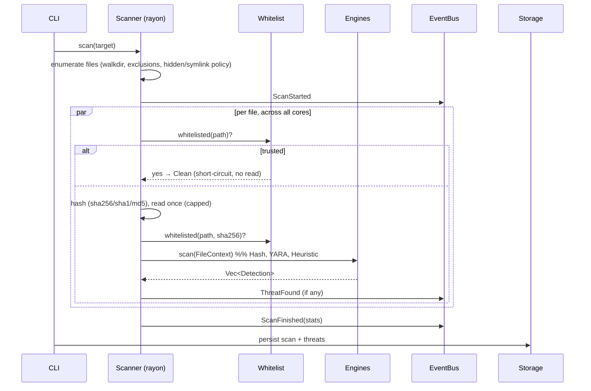
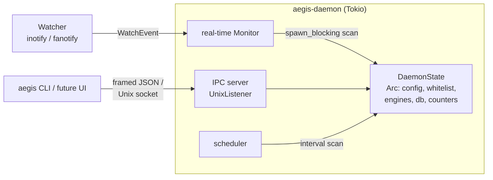

# Aegis Architecture

## Principles

Aegis follows **Clean Architecture** and **Domain-Driven Design**: dependencies
point inward, the domain layer (`aegis-core`) knows nothing about I/O, SQL,
crypto or UI, and each outer layer depends only on the ones beneath it. This
keeps the security-critical logic small, `unsafe`-free, and unit-testable.

Cross-cutting patterns in use:

| Pattern | Where |
|---|---|
| **Strategy** | `Engine` trait — each detection backend is interchangeable |
| **Repository** | `aegis-storage` — SQL hidden behind `ScanRepository` / `QuarantineIndex` |
| **Observer / Event Bus** | `aegis_core::EventBus` — engines publish, front-ends subscribe |
| **Composition Root / DI** | `aegis-cli::context::App` wires services together |
| **Builder-ish factory** | `aegis_engine::default_engines()` assembles the engine set from config |

## Crate graph



`aegis-core` has **no internal dependencies** — it is the stable center.

## Scan data flow



### Why the whitelist is checked first
Trusted project files short-circuit to `Clean` **before hashing or reading**,
which (a) eliminates false positives on your own code and (b) makes re-scanning
a large trusted tree nearly free.

### Zero-copy engine fan-out
Each file is read from disk **once** into a capped buffer, then every engine
receives the same `&[u8]` via `FileContext`. N engines cost one read, not N.

## Detection engines (Milestone 1)

| Engine | Technique | Severity |
|---|---|---|
| **Hash** | O(1) set lookup of SHA-256 against a known-bad DB | Critical on match |
| **YARA** | `yara-x` rules (bundled + user); metadata drives severity | rule-defined |
| **Heuristic** | Shannon entropy on ELF/PE, packer markers, behavioural byte-patterns (reverse shells, droppers, miners, persistence) | Low–High |

A file's final severity is the **max** across all engine detections, so
independent engines reinforce each other (consensus).

## Security posture

- `#![forbid(unsafe_code)]` in every crate.
- Quarantine uses **AES-256-GCM** (authenticated encryption): confidentiality +
  tamper detection. The vault key is a per-install 256-bit random key stored
  `0600`; the quarantine directory is `0700`.
- No hardcoded secrets. No network calls in M1 (offline by default).
- The daemon unit (`packaging/aegis-daemon.service`) is pre-hardened with the
  systemd sandbox (`ProtectSystem=strict`, dropped capabilities, seccomp
  `@system-service`) ahead of the M2 daemon.

## Performance design

- **Parallelism**: rayon work-stealing over the file list; scales to all cores.
- **Single read** per file, capped (default 8 MiB scan window, configurable).
- **Streaming hashing**: SHA-256/1/MD5 computed in one pass over 1 MiB chunks.
- **Release profile**: thin LTO, `codegen-units = 1`, `panic = "abort"`, stripped.
- Benchmarks (`cargo bench -p aegis-engine`) cover entropy and hashing hot paths.

## Testing strategy

- **Unit tests** live beside the code in every module (`#[cfg(test)]`).
- **Behavioural tests** assert real detections (EICAR, reverse shells) and the
  whitelist short-circuit end-to-end through the orchestrator.
- **Crypto round-trip tests** prove quarantine restore is byte-identical and
  that a tampered blob is rejected by the GCM tag.

## Daemon & real-time protection (Milestone 2)

The daemon (`aegis-daemon`) runs three concurrent Tokio tasks over shared,
`Arc`-wrapped [`DaemonState`] (config/whitelist behind `RwLock`, counters as
atomics). The engine set is compiled **once** at startup and shared via `Arc`,
so neither real-time events nor IPC scans ever recompile YARA.



### Real-time pipeline
A `Watcher` (Strategy pattern again) turns filesystem activity into
`WatchEvent`s on a dedicated OS thread, forwarded over an mpsc channel. The
`Monitor` consumes them, runs each scan via `spawn_blocking` (so a slow scan
never stalls the reactor), and on a threat records history and — if
`auto_quarantine` — seals the file in the encrypted vault. Decoupling the event
*source* from the *response* lets the whole detect-and-respond path be
unit-tested with synthetic events, no kernel privileges required.

* **inotify** (`InotifyWatcher`): unprivileged, per-directory, recursive by
  dynamically watching new subdirectories. Scans on `CLOSE_WRITE`/`MOVED_TO` —
  the moment a downloaded/extracted file is complete. Default backend.
* **fanotify** (`FanotifyWatcher`, `--features fanotify`): mount-wide, requires
  `CAP_SYS_ADMIN`; the basis for future blocking/prevention mode. Falls back to
  inotify when privileges are missing.

### IPC transport choice
The control plane is **framed JSON over a Unix domain socket** (4-byte length
prefix + JSON, 16 MiB cap), not HTTP. For a local privileged daemon this is the
idiomatic, minimal-attack-surface option (cf. systemd/Docker/containerd) and is
trivially testable over an in-memory duplex. The same `aegis-ipc` types will
back the Tauri UI. HTTP/Axum is reserved for a *network-facing* management API
if one is ever added (M5).

### Lifecycle
`Type=notify`: the daemon calls `sd_notify(READY=1)` once all tasks are up and
`STOPPING=1` on teardown. Shutdown is triggered by SIGTERM, SIGINT, or an IPC
`Shutdown`, and unblocks a `tokio::sync::Notify` every task selects on; the
control socket is removed on exit.

## Behavioural engine (Milestone 3)

`aegis-behavior` adds signature-less, activity-based defence. Every detector is
built around **pure, testable cores** with the live system wired in at the edges.

* **Ransomware guard** (`ransomware`) — a time-injectable sliding-window
  detector. `observe(path, kind, entropy, pid, now_ms)` is a pure function, so
  the entire decision (write-burst + high-entropy → *MassEncryption*; many
  same-extension renames → *RenameStorm*) is unit-tested deterministically. The
  daemon's `Monitor` feeds it every file event (computing content entropy),
  records a threat on alert, and — when the fanotify backend attributes a PID —
  calls `response::kill_pid`. With inotify (no PID) it alerts without killing.
* **Rootkit scanner** (`rootkit`) — cross-view detection: a fact seen two ways,
  any disagreement flagged. Hidden processes compare a **task-aware** `/proc`
  listing (union of every `task/` dir, so threads aren't false-positived)
  against a direct-stat probe, with a second pass to absorb races. Hidden
  modules diff `/proc/modules` against `/sys/module`. Parsers are pure and
  unit-tested; the live scan wires them to the filesystem.
* **Memory scanner** (`memory`) — a pure `/proc/<pid>/maps` parser + classifier
  flags W^X regions, anonymous executable memory, and executables backed by a
  deleted file (fileless malware).
* **Sandbox** (`sandbox`) — `landlock` (safe crate) builds a filesystem
  allow-list domain; `nix` sets rlimits. A launcher restricts *itself* then
  `exec`s the target (safe `CommandExt::exec`), so the confinement is inherited
  with no `unsafe` and no fork.

All of `aegis-behavior` is `#![forbid(unsafe_code)]`; process control and
Landlock go through safe `nix`/`landlock` wrappers.

## Forward-looking module layout

The spec's module list maps onto future crates, added milestone by milestone:

```
aegis-core        ✅ domain
aegis-engine      ✅ scanner/engine/heuristics   (+ M3: behavior, memory, rootkit)
aegis-storage     ✅ persistence
aegis-quarantine  ✅ quarantine
aegis-daemon      ✅ M2  daemon, scheduler, inotify/fanotify real-time
aegis-ipc         ✅ M2  framed-JSON IPC over UDS (daemon ⇄ CLI/UI)
aegis-behavior    ✅ M3  ransomware guard, rootkit/memory scan, Landlock sandbox
aegis-firewall    ▢ M5  nftables manager
aegis-network     ▢ M5  network IDS
aegis-plugins     ▢ M5  signed plugin SDK
aegis-ui (Tauri)  ▢ M4  React/TS/Tailwind/shadcn
```
