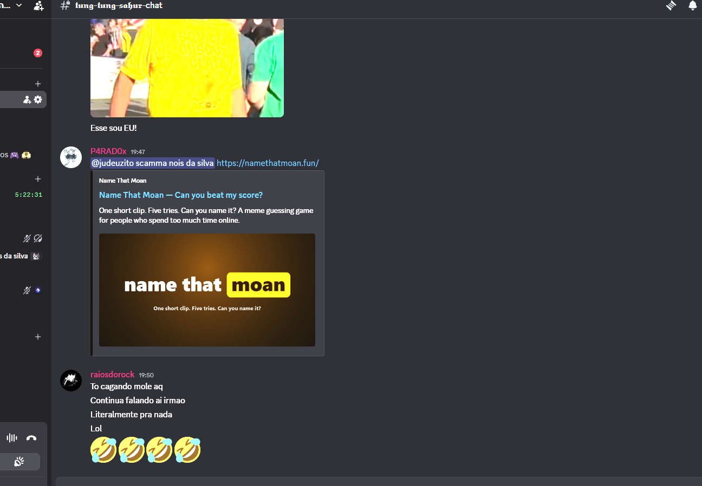
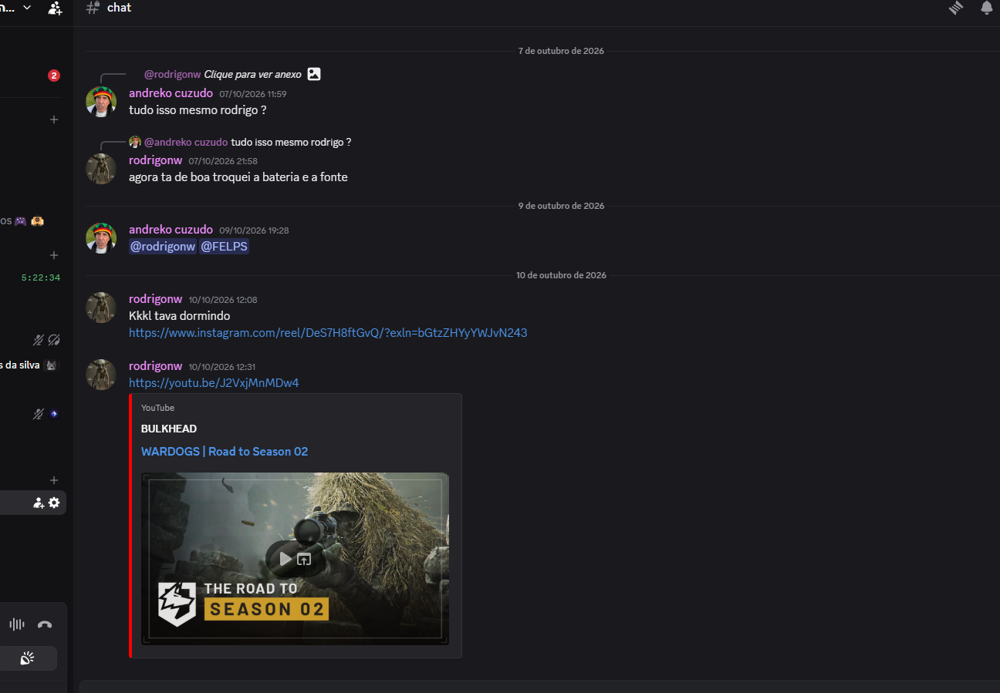
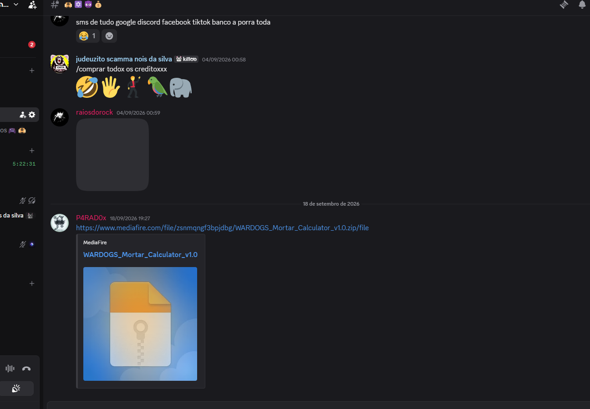
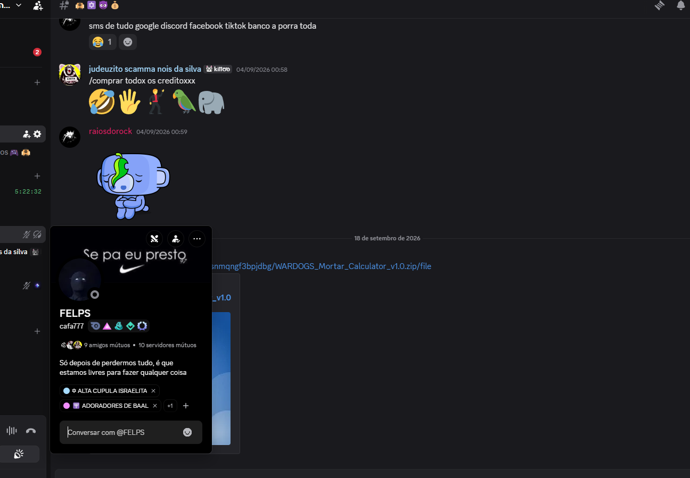

# Aegis Antivirus & EDR — Official Documentation Wiki

Welcome to the comprehensive technical documentation and system manual for **Aegis Antivirus & EDR**, an ultra-modern hybrid Windows, Linux, and Android Next-Generation Antivirus (NGAV) and Endpoint Detection & Response (EDR) platform written in pure, memory-safe Rust with a native desktop interface powered by Tauri v2 and ReactBits interactive motion engineering.

---

## 📸 Desktop Application Interface

| Endpoint Defense Center (Dashboard) | Modular Security Shields & Settings |
|---|---|
|  |  |

| Multi-Engine Malware Scanner | ChaCha20-Poly1305 Quarantine Vault |
|---|---|
|  |  |

---

## 📚 Wiki Table of Contents

| Section | Topic & Scope |
|---|---|
| [1. Architecture & Crates](Architecture-and-Crates.md) | Exhaustive dissection of all 13 workspace crates, Domain-Driven Design (DDD), Clean Architecture layers, lock-free concurrency, and `#![forbid(unsafe_code)]`. |
| [2. Detection Engines & Rules](Detection-Engines-and-Rules.md) | YARA-X AST rules (wipers, ransomware, stealers, RATs, droppers), precompiled binary search table (<500ns), Shannon section entropy, Goblin PE/ELF parser hardening, and Android APK/DEX Dalvik bytecode engine. |
| [3. In-Memory & Evasion Shields](In-Memory-and-Evasion-Shields.md) | Deep technical breakdown of Module Stomping `.text` diffing, FunctionPeekaboo TEB inspection, unbacked execution hunting, Early Cascade injection, and Process Execution DAG anomaly scoring with AI agent visibility. |
| [4. Malware Database Benchmarks](Malware-Database-Benchmarks.md) | Full real-world audit across all 2010–2026 malware families from `cryptwareapps/Malware-Database` (97.4% overall detection rate across 581 files; 100.0% on real compiled binaries). |
| [5. Cryptographic Quarantine Vault](Cryptographic-Quarantine-Vault.md) | ChaCha20-Poly1305 AEAD (`AEGIS_CHACHA_V1`) encryption, authenticated nonces, DPAPI master key derivation, and byte-identical lossless restoration proof. |
| [6. Telemetry & Training Gateway](Telemetry-Training-Gateway.md) | Hyper-V and WSL2 guest VM orchestration, port 9090 REST API (`/train.py`, `/api/v1/telemetry/report`, `/api/v1/train/feedback`). |
| [7. Desktop UI & ReactBits Manual](Desktop-UI-Manual.md) | ReactBits design system (SpotlightCard, ShinyText, DecryptedText, Magnet, CountUp), global right-click context menus, and dark tone-stepped surfaces. |
| [8. CLI & Command Reference](CLI-and-API-Reference.md) | Comprehensive CLI command guide (`aegis scan`, `aegis quarantine`, `aegis sandbox`, `aegis gateway`). |
| [9. Building & Installation](Building-and-Installation.md) | Cross-platform build instructions for Windows (MSVC/MinGW), Linux (x86_64, fanotify, landlock), WSL2 Ubuntu, and Android. |

---

## 🏛️ System Architecture Topology

```text
                                  +-------------------------------------------------------------+
                                  |                      Aegis User Interface                   |
                                  |               (Tauri v2 + ReactBits Desktop Shell)          |
                                  +------------------------------+------------------------------+
                                                                 |
                                              Tauri IPC Command Bridge / Named Pipes
                                                                 |
                                  +------------------------------v------------------------------+
                                  |                     Aegis Engine Orchestrator               |
                                  +------------------------------+------------------------------+
                                                                 |
         +-----------------------+-------------------------------+------------------------------+------------------------+
         |                       |                               |                              |                        |
         v                       v                               v                              v                        v
+-----------------+     +-----------------+             +-----------------+            +-----------------+      +-----------------+
|   Hash Engine   |     |  YARA-X Engine  |             | Heuristic Engine|            |    ML Engine    |      | Behavioral Guard|
| (Binary Search) |     | (AST Compiler)  |             | (Entropy/RTLO)  |            |   (GBDT Model)  |      | (Memory/Process)|
+-----------------+     +-----------------+             +-----------------+            +-----------------+      +-----------------+
         │                       │                               │                              │                        │
         +-----------------------+-------------------------------+------------------------------+------------------------+
                                                                 |
                                  +------------------------------v------------------------------+
                                  |                      File / Process Verdict                 |
                                  |                 (Consensus Scoring & Reporting)             |
                                  +------------------------------+------------------------------+
                                                                 |
                                           Threat Detected? ─────┴───── Clean File
                                                  │                          │
                                                  v                          v
                                  +-------------------------------+    Cache Verdict
                                  |     Quarantine Vault          |
                                  |   (ChaCha20-Poly1305 AEAD)    |
                                  +-------------------------------+
```

---

## 🛡️ Core Engineering Invariants

1. **Zero-Compromise Memory Safety**: 100% Rust workspace outside `crates/aegis-platform` with `#![forbid(unsafe_code)]`.
2. **Zero C++ Runtime Dependencies**: Runs without bulky external runtimes (`onnxruntime.dll`, MSVC redistributables, or C++ wrappers). Static compilation produces lightweight, high-performance binaries.
3. **Anti-Slop Design Taste**: Strictly tone-stepped opaque surfaces (`#0C0D12` / `#12141D`), honest action-first copy, tactile micro-interactions (`active:scale-[0.98]`), and tabular monospace figures for quantitative metrics.
4. **Resilient Binary Parsing**: All PE and ELF parsing operations via `goblin` are wrapped in `std::panic::catch_unwind(AssertUnwindSafe(...))` with `panic = "unwind"`, ensuring weaponized malware with corrupt TLS headers cannot crash the antivirus engine.
